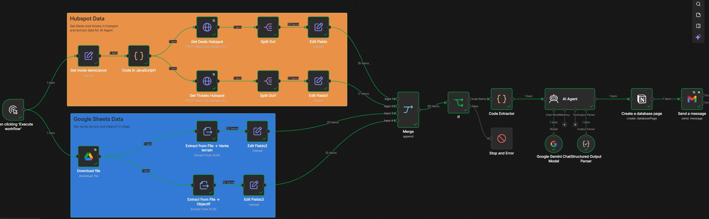

# 📊 Reporting Hebdomadaire Automatisé (HubSpot + Google Sheets + IA + Notion)

Workflow n8n qui consolide 4 sources de données, génère une synthèse rédigée par IA, 
la publie dans Notion et notifie la direction par email.

---

## 🎯 Le problème

Dans une PME ou un centre d'appel, produire le rapport hebdomadaire d'activité est 
un exercice chronophage et source d'erreurs :

- **Multiplicité des sources** : les ventes structurées sont dans le CRM (HubSpot), 
  les ventes terrain (formations, prestations ponctuelles) dans un Google Sheet, 
  les tickets support dans un autre outil, et les objectifs dans un fichier Excel 
  séparé. Personne n'a de vue consolidée sans faire d'exports manuels.
- **Temps de production élevé** : chaque lundi, un chargé de reporting passe environ 
  **2 heures** à exporter les données, les agréger dans Excel, rédiger une synthèse 
  et la mettre en forme dans un document. Ce temps est pris sur des missions à 
  plus forte valeur.
- **Risque d'incohérence** : les chiffres calculés manuellement varient d'une 
  semaine à l'autre (oublis de lignes, formules cassées), ce qui nuit à la 
  confiance de la direction dans les indicateurs.
- **Alertes tardives** : les anomalies (pic de tickets critiques, impayés qui 
  s'accumulent, retard sur les objectifs) ne sont détectées qu'à la lecture du 
  rapport — parfois trop tard pour réagir.

---

## 💡 La solution

Un workflow n8n planifié qui **automatise de bout en bout** la production du rapport :

1. **Consolidation automatique** : le workflow interroge HubSpot (deals + tickets) 
   et Google Sheets (ventes terrain + objectifs) via leurs API, puis fusionne les 
   4 sources en un jeu de données unique.
2. **Calcul des KPI** : un nœud Code calcule le CA consolidé (CRM + terrain payé), 
   le taux d'atteinte des objectifs, les tickets critiques ouverts, les impayés — 
   avec une logique métier explicite (pas de formule Excel fragile).
3. **Rédaction par IA** : un agent LLM (Gemini) reçoit ces KPI sous forme structurée 
   et rédige une synthèse en 3 sections (Points clés / Tendances / Recommandations), 
   avec des consignes strictes pour ne jamais inventer de chiffre et signaler les 
   anomalies en ⚠️ ALERTE.
4. **Publication et notification** : la synthèse est publiée dans une base Notion 
   (page structurée avec titres, alertes et liste des tickets critiques), puis un 
   email HTML est envoyé à la direction avec les 3 métriques clés et un lien direct 
   vers la page Notion.

**Résultat** : le rapport est prêt **en 2 minutes**, avec des chiffres toujours 
cohérents, des alertes automatiques, et une trace consultable dans Notion.

---

## 🏗️ Architecture
[schéma]
Schedule Trigger → Sources (HubSpot + Sheets) → Merge → Code (KPI) 
→ AI Agent (synthèse) → Notion → Gmail

*Rapport avec 3 sections, alerte conditionnelle et liste des tickets critiques*

*Email HTML avec 3 métriques, alerte orange et bouton vers Notion*

**Principe de séparation des responsabilités** : le Code calcule tous les chiffres, 
le LLM rédige uniquement le texte, et les outils (Notion, Gmail) publient le résultat. 
Aucun chiffre ne transite par le LLM en dehors des KPI fournis.

---

## 🛠️ Stack technique

- **n8n** (self-hosted 2.44.6)
- **HubSpot CRM API v3** (Search API pour deals + tickets)
- **Google Sheets API** (nœud natif, 2 onglets : ventes terrain + objectifs)
- **Gemini 3 Flash Preview** (synthèse via AI Agent + Structured Output Parser)
- **Notion API** (nœud natif, blocs Heading 2/3 + Paragraph)
- **Gmail** (nœud natif, email HTML + lien Notion)

---

## 📊 Résultats mesurés

| Métrique | Avant | Après | Gain |
| :--- | :--- | :--- | :--- |
| Temps de production | ~2h | ~2 min | **-98 %** |
| Sources consolidées | 1 (export manuel) | 4 (HubSpot + Sheets) | +3 |
| Alertes automatiques | 0 | 3 types (tickets, impayés, objectif) | +3 |
| Coût LLM | - | ~0,02 € / rapport | négligeable |
| Fiabilité | humaine | X/Y exécutions réussies | à compléter |

---

## 🧠 Compétences démontrées

- **Intégration d'API REST** : HubSpot (Search API v3), Google Sheets, Notion
- **Agrégation multi-sources** : Merge 4 entrées + traitement conditionnel par type
- **LLM engineering** : prompt système strict, Structured Output Parser, limitation 
  des hallucinations
- **Séparation des responsabilités** : le LLM rédige, le code calcule, l'outil publie
- **Feature flag** : bascule DEMO/PROD sans modifier le workflow
- **Gestion d'erreurs** : Retry On Fail sur nœuds critiques, IF + Stop and Error

---

## 🚀 Reproductibilité

1. **Importer** `workflow.json` dans n8n (`⋯` → `Import from File`)
2. **Configurer les 5 credentials** : HubSpot, Google, Gemini, Notion, Gmail
3. **Créer le Google Sheet** `Ventes_Demo` avec 2 onglets, coller les CSV de 
   `data-sample/`
4. **Créer la base Notion** `Rapports hebdomadaires` avec les propriétés 
   `Titre`, `Date`, `CA signé`, `Taux conversion`, `Tickets ouverts`, `Alerte`
5. **Partager la base** avec l'intégration Notion (⋯ → Connexions)
6. **Exécuter manuellement** une fois pour vérifier la chaîne complète
7. **Activer le Schedule Trigger** pour les exécutions automatiques

---

## 📁 Structure du dépôt
n8n-reporting/
├── README.md
├── workflow.json
├── data-sample/
    ├── ventes.csv
    └── objectifs.csv
└── screenshots/
    ├── canvas.png ← canevas n8n avec Sticky Notes
    ├── notion.png ← page Notion générée
    └── email.png ← email reçu

---

## ⚠️ Mode DEMO vs Mode PROD

Le workflow fonctionne avec **deux modes**, contrôlés par un seul champ (`Set (mode)`) 
en début de workflow. Aucun nœud n'est déplacé pour basculer entre les deux.

### Mode DEMO (par défaut dans ce dépôt)

Utilisé pour la **démonstration** et les tests. Il ne filtre **pas** les données 
par date.

- **Deals HubSpot** : retourne les 20 derniers deals, tous statuts confondus
- **Tickets HubSpot** : retourne les 20 derniers tickets
- **Ventes terrain** : lit **toutes** les lignes du Sheet, sans filtre
- **Objectifs** : filtre sur le mois courant (`2026-10` actuellement)

**Conséquence** : le rapport contient toujours des données, même si la semaine 
réelle est creuse. C'est utile pour montrer le workflow à un recruteur ou à un 
client à tout moment, mais **ce n'est pas un vrai rapport hebdomadaire** — c'est 
une démonstration de la mécanique.

### Mode PROD (à activer en production)

Utilisé pour un **vrai rapport hebdomadaire**. Il filtre automatiquement sur la 
semaine précédente.

- **Deals HubSpot** : filtre `closedate BETWEEN` lundi 00:00 et dimanche 23:59 
  de la semaine précédente
- **Tickets HubSpot** : filtre `createdate BETWEEN` la même fenêtre
- **Ventes terrain** : *(filtre de date non implémenté — voir limitations)*
- **Objectifs** : filtre sur le mois courant

**Pour basculer en PROD** : dans le nœud `Set (mode)`, remplacer `DEMO` par 
`PROD`. Rien d'autre à toucher.

---

## ⚠️ Limitations connues

Ce projet est fonctionnel mais comporte des limites **assumées et documentées**. 
Elles sont listées ici avec les pistes d'amélioration associées, pour montrer 
l'honnêteté technique du projet.

### 🔴 Limitation 1 : filtre de date sur les ventes terrain non implémenté

Contrairement aux deals et tickets HubSpot (filtrés sur la semaine en mode PROD), 
les ventes terrain sont **toujours comptées en totalité**, sans filtre sur la 
colonne `Date`.

**Conséquence** : en production, le CA terrain devient **cumulatif** au fil des 
semaines. En novembre 2026, le workflow compterait les 20 ventes d'octobre comme 
si elles étaient de novembre.

**Piste d'amélioration** : ajouter un filtre `Date` dans le Code Extractor, 
aligné sur le mode :
- PROD : `Date BETWEEN semaine précédente`
- DEMO : `Date >= 30 derniers jours`

### 🔴 Limitation 2 : objectifs à mettre à jour manuellement

Le filtre `Objectifs` ne matche que le mois courant. Si l'onglet `Objectifs` ne 
contient pas les lignes du mois en cours, `objectifTotal = 0` et le rapport 
affiche "atteinte 0 %" ou "objectif non renseigné".

**Conséquence** : en novembre 2026, sans mise à jour du Sheet, le rapport 
indiquera un objectif à 0 € au lieu de dire "objectif non disponible".

**Piste d'amélioration** : ajouter un fallback automatique sur le mois précédent, 
avec mention explicite dans le rapport ("objectif de référence : octobre").

### 🟡 Limitation 3 : pas de déduplication

Si le workflow tourne plusieurs fois dans la même semaine (exécution manuelle + 
planifiée), les mêmes deals et tickets sont recomptés. Le rapport n'est pas 
idempotent.

**Piste d'amélioration** : persister `lastRunAt` dans un Google Sheet et filtrer 
sur `hs_lastmodifieddate > lastRunAt`.

### 🟡 Limitation 4 : gras en Markdown non interprété dans Notion

Les sujets des tickets critiques sont entourés de `**` pour le gras. Comme le 
nœud Notion natif n'interprète pas le Markdown, les astérisques s'affichent 
littéralement dans les blocs Paragraph.

**Piste d'amélioration** : construire les blocs `bulleted_list_item` via HTTP 
Request avec `annotations.bold: true`, ou utiliser un nœud communautaire de 
conversion Markdown → Notion.

### 🟡 Limitation 5 : pas de gestion d'erreur globale

En cas d'échec d'un nœud critique (API indisponible, credentials expirés), le 
workflow s'arrête sans notification. Aucun log n'est conservé.

**Piste d'amélioration** : associer un **Error Workflow** (log dans Google Sheet 
+ notification Gmail/Slack) dans les Settings du workflow.

---

## 🎯 Pistes d'amélioration

- Ajouter un **log d'exécution** dans un Google Sheet (date, statut, durée, coût LLM)
- Implémenter un **Error Workflow** global
- Comparer la semaine N avec la semaine N-1 (calcul de variation)
- Ajouter un **graphique** dans la page Notion (CA par vendeur, tickets par priorité)
- Étendre le workflow au **rapport mensuel**
- Remplacer les blocs Paragraph Notion par des **vrais tableaux** via l'API Notion brute

---
